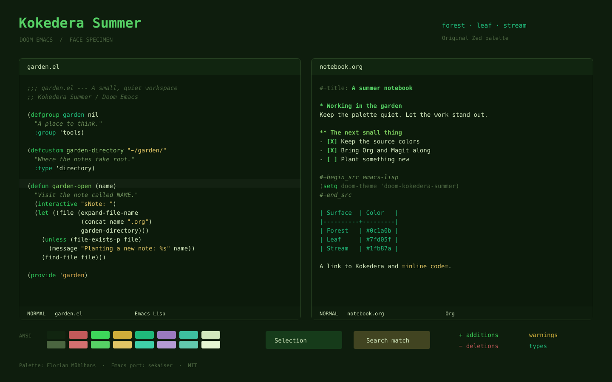

# Kokedera Summer for Doom Emacs

A port of [Kokedera Summer](https://github.com/cappuccinotogo/kokedera-theme-extension-zed) by Florian Mühlhans, built with [doom-themes](https://github.com/doomemacs/themes).

Deep forest backgrounds, fresh green keywords, golden strings and teal types. The editor, syntax and ANSI colors follow the Zed palette. Emacs-specific faces extend that palette to Org, Magit, completion menus, diagnostics and the Doom modeline.



*Face specimen generated from the loaded theme and fontified Emacs buffers; not a screenshot. Font shown: Fira Code when available.*

## Doom Emacs

Add to `packages.el`:

```elisp
(package! doom-kokedera-summer-theme
  :recipe (:host github
           :repo "sekaiser/doom-emacs-theme-kokedera"))
```

Set in `config.el`:

```elisp
(setq doom-theme 'doom-kokedera-summer)
```

Run `doom sync`, then restart Emacs. If your installation manages Doom through Nix, rebuild that configuration instead.

## Other Emacs configurations

Requires Emacs 27.1+ and doom-themes 2.3.0+. Current doom-themes is recommended. Clone this repository, install `doom-themes`, and add the checkout to your theme path:

```elisp
(require 'doom-themes)
(add-to-list 'custom-theme-load-path "/path/to/doom-emacs-theme-kokedera")
(load-theme 'doom-kokedera-summer t)
```

For a pinned Nix source, declare a non-flake input:

```nix
inputs.kokedera-theme = {
  url = "github:sekaiser/doom-emacs-theme-kokedera";
  flake = false;
};
```

Then interpolate its store path into your Doom `config.el`:

```nix
''
  (add-to-list 'custom-theme-load-path "${inputs.kokedera-theme}")
  (setq doom-theme 'doom-kokedera-summer)
''
```

The input supplies the theme file; your Emacs configuration must still include doom-themes.

## Comments and emphasis

Summer's original comments are deliberately subdued. To use the source documentation color for ordinary comments, set this **before** the theme loads:

```elisp
(setq doom-kokedera-summer-brighter-comments t)
```

The theme also respects `doom-themes-enable-bold` and `doom-themes-enable-italic`. Reload it after changing these settings.

True-color displays reproduce the source palette. 256- and 16-color terminals use fallback colors. Translucent Zed selection, search and diagnostic backgrounds are composited against the editor background because Emacs faces use opaque colors.

## Development

With doom-themes on your Emacs load path:

```sh
make check
# Or point at a checkout:
make check DOOM_THEMES_DIR=/path/to/doom-themes
make preview
```

Tests compare the theme against the pinned source fixture, including syntax roles, all normal and bright ANSI colors, vterm, overlays, terminal fallbacks, Org fontification and customization. CI tests the stable and current Doom bases on Linux; local checks also cover Emacs 31.1 on macOS. Like Doom's bundled themes, this theme is loaded as source rather than byte-compiled.

## Source and license

The Summer palette is adapted from [`themes/kokedera.json` at `7455512f5e69`](https://github.com/cappuccinotogo/kokedera-theme-extension-zed/blob/7455512f5e694128f430d1db0e6e2836efca902b/themes/kokedera.json), copyright © 2026 Florian Mühlhans. [The fixture](test/fixtures/kokedera-summer.json) records the source commit and blob so color changes can be reviewed.

Emacs port copyright © 2026 sekaiser. Both are distributed under the [MIT license](LICENSE).
